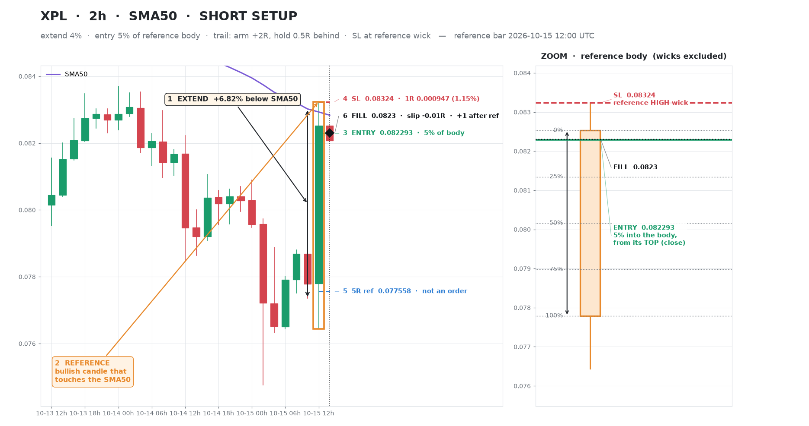
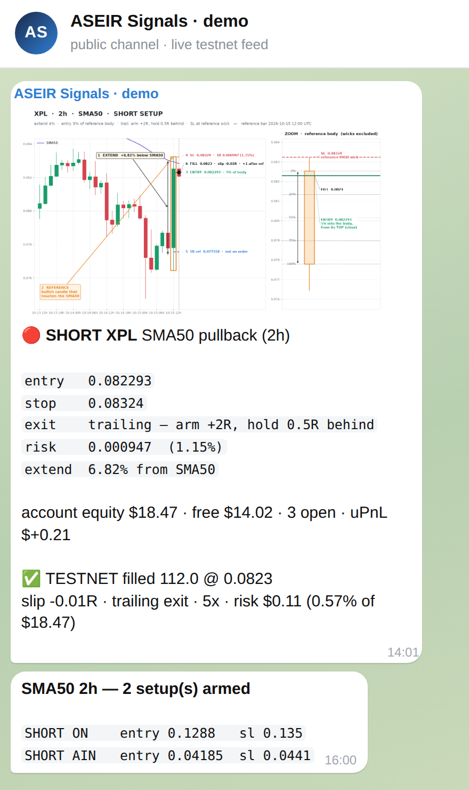
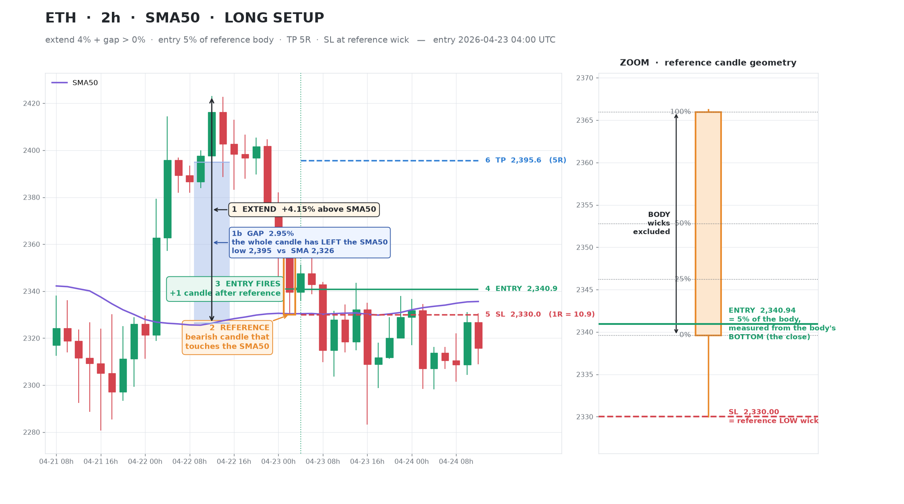
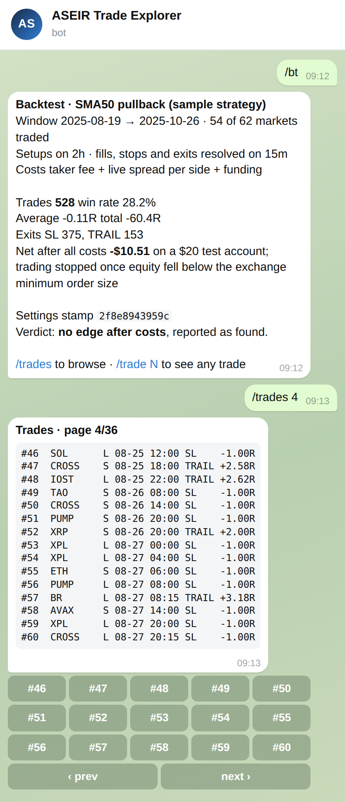
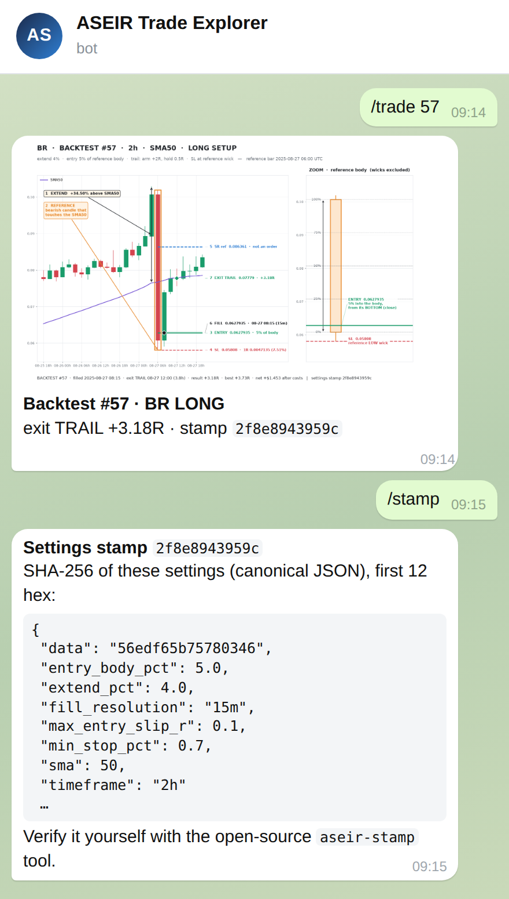
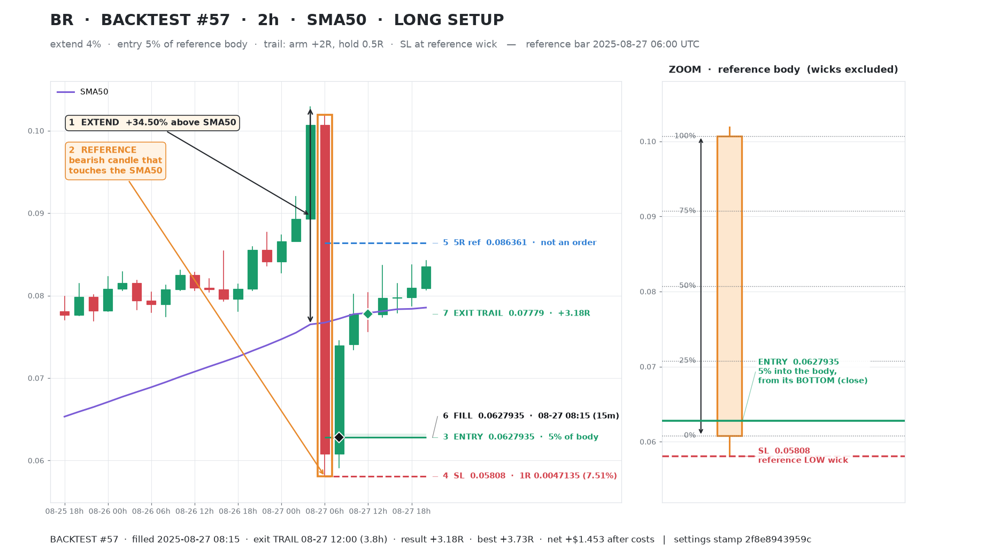
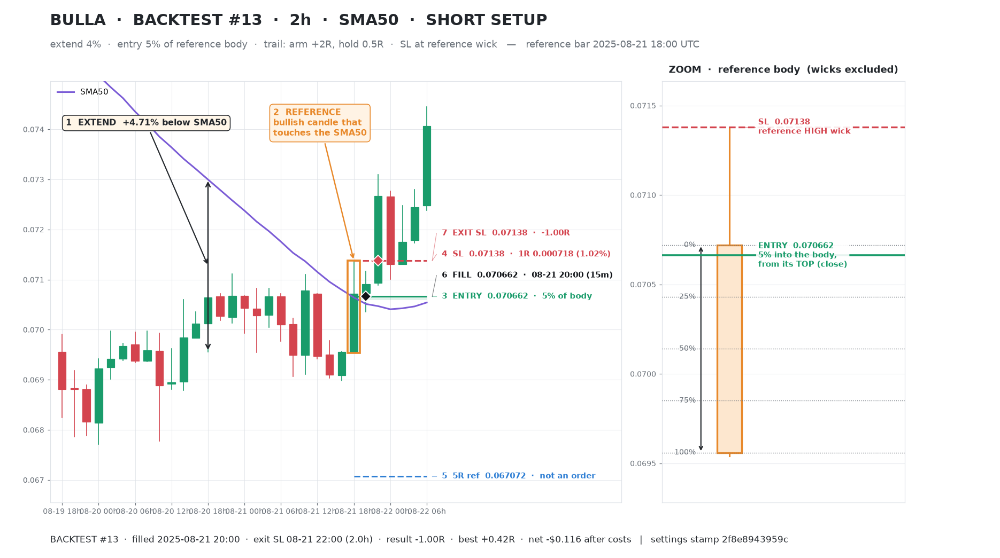
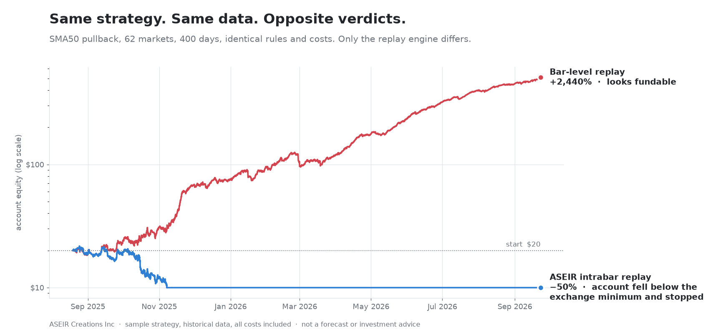
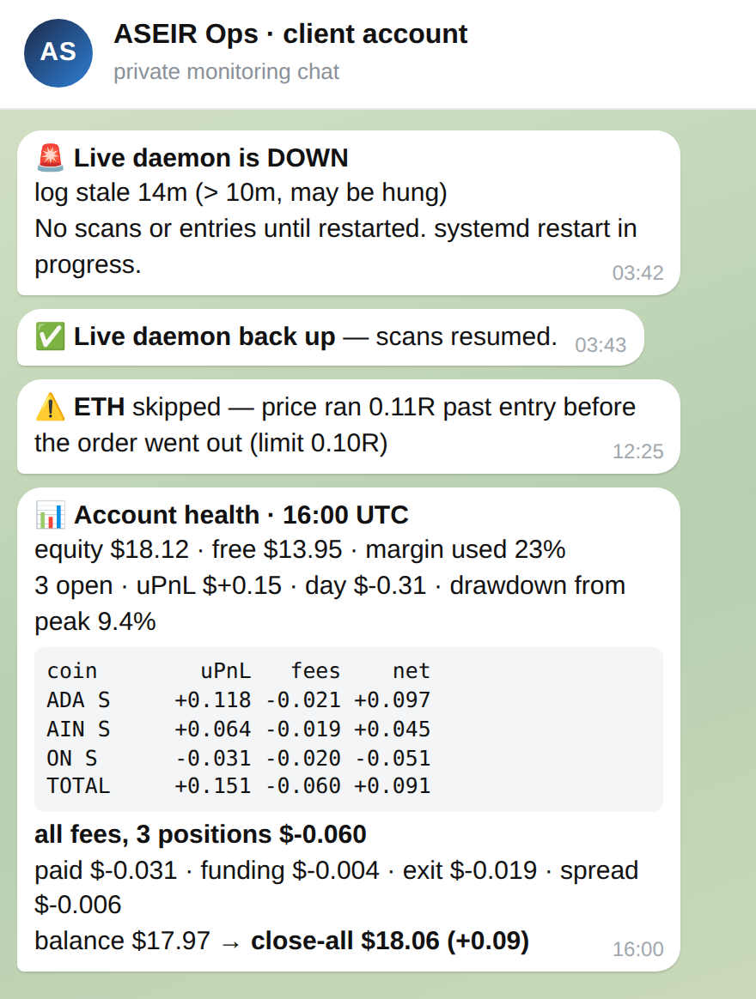

<div align="center">

# ASEIR Creations · Trading Automation

**Custom alert systems, exchange integration and verifiable backtesting,
delivered and monitored inside Telegram.**

[](https://github.com/ASEIR-Creations-Inc/trading-automation/actions/workflows/ci.yml)


</div>



<sub>A real alert from our live demo system (Binance futures testnet). One image, no chart-hopping:
the trend leg that qualified the setup, the reference candle, a zoom on the entry geometry,
where the order actually filled and how far it slipped.</sub>

---

## What we build

You bring the trading idea. We engineer everything around it, then keep it running.

| | |
|---|---|
| **Signal engines & alerts** | Your rules, in plain language, turned into a scanner that watches every market you care about and fires the moment a setup qualifies. |
| **The setup inside the alert** | Every alert is a chart built for *your* method: the levels, the candles that qualified it, the entry geometry. You confirm the setup in the message, not in five TradingView tabs. |
| **Execution integration** | Orders placed on your demo account first, then on your live account once you approve. Brackets, slippage guards, position sizing and margin checks included. |
| **Account health loop** | Equity, free margin, open positions, fees, funding and drawdown reported to Telegram on your schedule, plus an immediate message on anything abnormal. |
| **Verifiable backtesting** | Tested at a resolution and cost model that matches live trading. Every trade in the result can be pulled up as a chart on demand. |
| **Operations** | Monitoring, watchdogs, exchange API changes, rule adjustments and monthly reporting. Managed by us, not left to you. |

---

## The setup, not just the signal

Most alert services send a ticker and an arrow. You still have to open a chart, find the
candles and work out whether the trigger was really valid. We close that gap: each alert
**is** the chart, drawn to the way you read your own setups, with every rule shown as a
numbered step.

<table>
<tr>
<td width="44%"></td>
<td>

**What arrives in your channel**

1. The chart: setup, levels, zoom on the entry candle, actual fill.
2. The order: entry, stop, exit plan, risk in price and percent.
3. The account: equity, free margin, open positions.
4. Execution: filled size and price, slippage against the plan, any size caps applied and why.

Before entry, at entry, or both. You decide what you want to see and when.

</td>
</tr>
</table>



<sub>Setup anatomy for our sample strategy (SMA50 pullback). Your strategy gets its own visual
language: Fibonacci levels, order blocks, session ranges, multi-timeframe panels, whatever
your rules are built on.</sub>

---

## Backtests you can audit, trade by trade

A backtest summary is easy to fake and hard to trust. Ours comes with a **trade explorer**:
browse the full trade list in Telegram and request any single trade as a chart, drawn in
exactly the same style as the live alerts.

<table>
<tr>
<td width="50%"></td>
<td width="50%"></td>
</tr>
</table>

Every image carries a **settings stamp**, a 12-character fingerprint of the exact parameters
*and* market data the run used. Change one setting or one candle and the stamp changes.
You can recompute it yourself with our open-source verifier:

```bash
pip install ./stamp
aseir-stamp verify examples/stamp-settings.json 2f8e8943959c
# OK  2f8e8943959c  settings match the stamp
```

This is also how we tune a strategy with you. If a trade looks wrong, request it, see exactly
what the engine saw, and we adjust the rule, not the story.

| A winning trade | A losing trade |
|---|---|
|  |  |

Full sample: [`examples/backtest-trades-sample.csv`](examples/backtest-trades-sample.csv) ·
settings: [`examples/stamp-settings.json`](examples/stamp-settings.json)

---

## Why the replay engine matters



Same strategy, same 62 markets, same 400 days, same fees. A conventional bar-level backtest
says **+2,440%**. Our engine, which resolves what happened *inside* each bar and applies the
exchange's real constraints, says the account loses half its value and then can no longer
place orders.

Both numbers come from the same rules. Only one would have survived contact with the
market. **We tell you which one before you fund it.** Most of what we deliver is
the engineering that keeps those two numbers apart:

- Market data store with multi-resolution caches, so reruns take seconds and are byte-for-byte reproducible.
- Fills, stops and exits resolved below the signal timeframe, with both best and worst cases where the data is ambiguous.
- Cost model priced from live conditions: taker fees, per-symbol spread, funding at each settlement.
- Account-level simulation: position sizing, margin limits, minimum order size, one position per symbol.
- Controls against self-deception: out-of-sample splits, random-entry baselines, parameter sweeps reported in full.

Methodology overview: [`docs/backtesting.md`](docs/backtesting.md)

---

## Account health, around the clock

<table>
<tr>
<td width="44%"></td>
<td>

**A private ops chat for your account**

- Scheduled health reports: equity, free margin, margin used, open positions, drawdown.
- A per-position fee breakdown: commission, funding, exit fee and spread, all priced live.
- "What if I close everything now", calculated net of every cost.
- Skipped entries reported with the reason: slippage, margin or minimum size.
- Watchdog alerts if the system stalls, and confirmation when it recovers.

</td>
</tr>
</table>

---

## How an engagement runs

1. **Brief.** You describe the strategy in your own words. A template is in [`examples/client-brief.yaml`](examples/client-brief.yaml).
2. **Specification.** We turn it into exact rules and send them back for sign-off. The approved settings get their stamp.
3. **Backtest and trade explorer.** You get the report plus a bot to inspect every trade. We iterate until each trade matches your intent.
4. **Demo account.** The system runs live against your exchange demo account, with alerts and health reports in Telegram.
5. **Go-live, on your approval.** The same system is switched to your live account, with risk limits you set.
6. **Operations.** Monitoring, maintenance and monthly reporting, on a retainer.

Scope, deliverables and service tiers: [`docs/engagement.md`](docs/engagement.md)

---

## Security and risk controls

- **Trade-only API keys**, withdrawals disabled, restricted to our server's IP. We never hold client funds.
- **Demo first, always.** Nothing touches a live account without your written approval.
- **Your strategy stays yours.** NDA on request; client rules are never reused or published.
- **No performance promises.** We engineer and test systems; we do not sell returns.

Details: [`docs/security.md`](docs/security.md)

---

## Platforms

| | |
|---|---|
| Running today | Binance USDⓈ-M futures: live demo system on testnet, around the clock since September 2026. Binance and MEXC historical data. |
| On request | Bybit, OKX, other CCXT-supported exchanges, TradingView webhooks, MetaTrader 5. Scoped and quoted per project. |
| Delivery | Telegram (channels, private chats, bots). Discord on request. |

---

## What is in this repository

This repository is a **showcase**. The images are real output from our systems, and the
sample backtest is real. The production stack (replay engine, cost model, execution layer,
chart renderer, monitoring) is proprietary. We give technical walkthroughs to prospective
clients under NDA.

Open source here: [`stamp/`](stamp/), the settings-stamp verifier, so you never have to take
our word for what was tested.

<sub>Telegram screenshots are rendered mockups built from our live message formats and the
trade explorer's real replies; account figures in the channel and ops-chat examples are
illustrative.</sub>

---

## Work with us

Open a **[project inquiry](https://github.com/ASEIR-Creations-Inc/trading-automation/issues/new?template=inquiry.yml)**
with a short description of your strategy and where you trade. We reply with questions, a
scope and a quote.

Or reach us directly: **iron8dao@gmail.com**

See live previews on our Telegram channel: **[t.me/Asiertradingpreview](https://t.me/Asiertradingpreview)**

Also from ASEIR Creations: **[KEYPOS](https://github.com/ASEIR-Creations-Inc/keypos)**, an
offline-first point of sale with a tamper-proof audit trail.

---

<sub>**Risk notice.** Trading leveraged products carries a high risk of loss. Backtests are
historical simulations and do not guarantee future results. The sample strategy shown here
is not profitable after costs and is published to demonstrate our tooling. Nothing in this
repository is investment advice.</sub>
